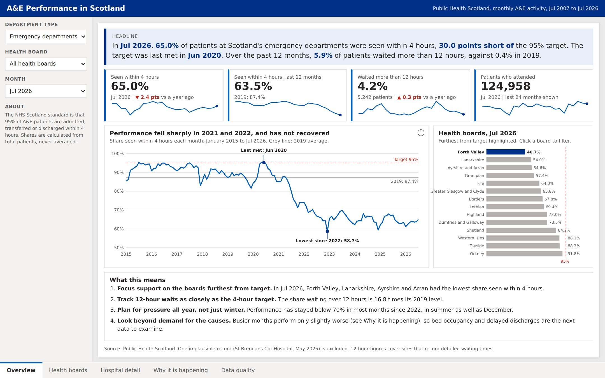
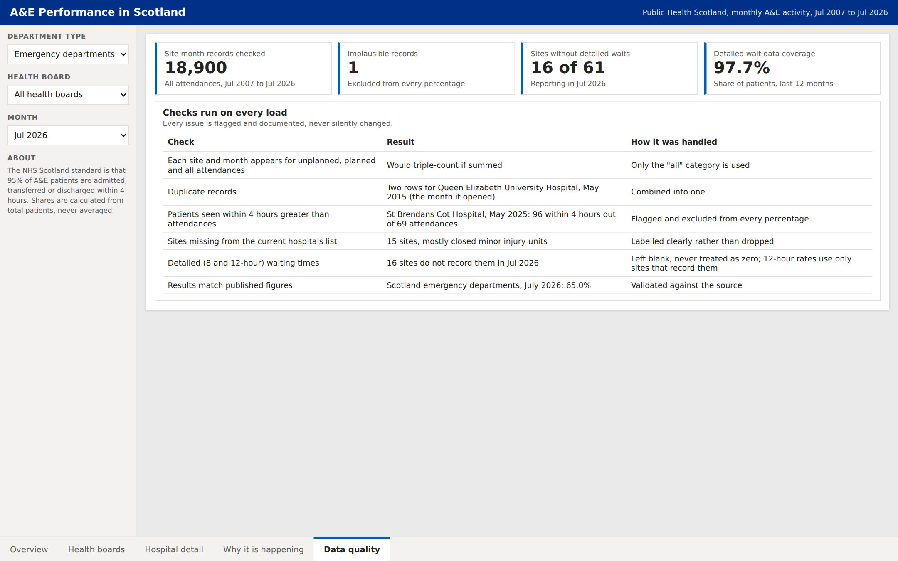
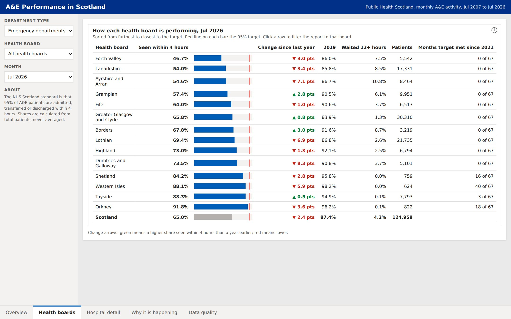
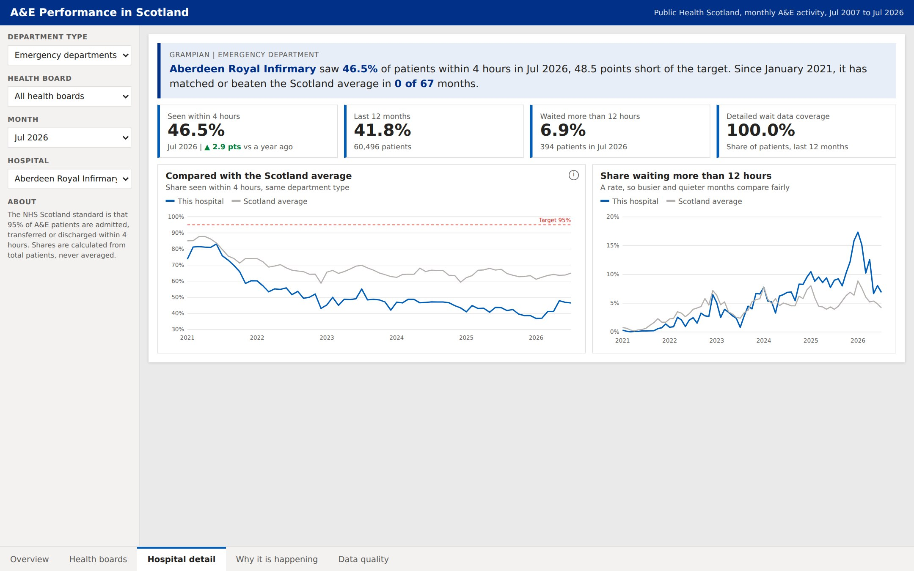
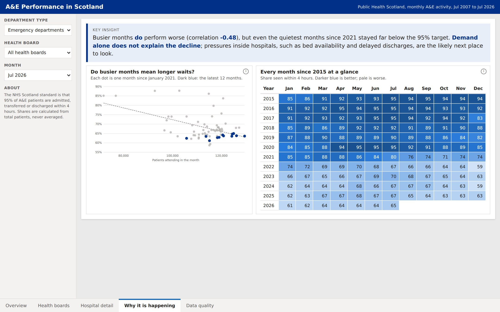

# A&E Performance in Scotland: Where and Why the 4-Hour Target Is Being Missed

**A business intelligence project on real NHS data, from requirements and a SQL Server data warehouse to an interactive dashboard and findings for decision-makers.**

**Skills:** Requirements gathering · KPI definition · SQL Server (T-SQL) · Data modelling (star schema) · Data quality checks · Power BI (DAX) · Dashboard design · Data storytelling

### Key findings

- **Emergency departments are far from the 95% target:** 63.5% of patients were seen within 4 hours over the last 12 months, down from 87.4% in 2019. The target was last met in June 2020.
- **Very long waits have grown almost fifteen-fold:** 75,079 patients waited more than 12 hours in 2025, against 5,084 in 2019.
- **A data quality check caught an error in the published data**, which was flagged and kept out of every result.

*Based on 39,905 monthly records from Public Health Scotland, July 2007 to July 2026.*

*Click the image to open the live, interactive dashboard.*

---

## 1. The business problem

NHS Scotland's standard is that **95% of patients attending A&E are admitted, transferred or discharged within 4 hours**. Public Health Scotland publishes the figures every month, but as large tables. Performance managers have no single view that compares health boards and hospitals, separates major emergency departments from minor injury units, and shows whether very long waits are getting better or worse.

The dashboard is designed for three groups of users:

| User | What they need |
|---|---|
| National performance lead | Scotland-wide trend and a comparison of all 14 health boards |
| Health board director | How their board compares, and which of their hospitals are struggling |
| Hospital site manager | Their own site's monthly performance and long waits |

It answers eight business questions, set out in the [requirements document](nhs_ae_requirements.pdf), including: Which boards and hospitals are furthest from the target? Are 12-hour waits rising? Do busier months perform worse? Is there a winter dip? Can the data be trusted?

## 2. The data

Three open datasets from Public Health Scotland, published under the UK Open Government Licence:

| Dataset | What it provides |
|---|---|
| Monthly A&E Activity | Attendances and patients seen within 4 hours, over 8 hours and over 12 hours, for every A&E site, every month since July 2007 |
| Current NHS Hospitals in Scotland | Hospital names and health boards |
| Health Board 2014 to 2019 | Health board names |

## 3. How I built it

| Stage | What I did |
|---|---|
| Requirements | Wrote a requirements document with stakeholders, eight business questions, KPI definitions and acceptance criteria |
| SQL Server | Loaded the raw files into staging tables, cleaned and typed the data, and built a star schema: one fact table with four dimensions (date, health board, hospital, department type) |
| Data quality | Wrote 11 automated checks that run on every load |
| Validation | Checked the results against the source data (July 2026: 65.0% for emergency departments, 92.7% for minor injury units, 69.1% overall) |
| Power BI model | Connected Power BI to SQL Server, set up the relationships and wrote DAX measures matching the KPI definitions |
| Design | Designed five pages as wireframes in the NHS colour palette before building |
| Dashboard | Built an interactive five-page dashboard in a Power BI-style layout, with slicers, page tabs, drill-down from health board to hospital, and a data-driven headline on every filter |

**Two rules that keep the numbers right:**
- **Percentages are always calculated from totals, never averaged,** so a small minor injury unit doesn't count as much as a large emergency department.
- **Each site and month appears three times in the raw data** (unplanned, planned and all attendances). Only "all" is used, to avoid double counting.

## 4. Data quality: what the checks found

| Issue | How it was handled |
|---|---|
| **An impossible figure:** in May 2025, St Brendans Cot Hospital on Barra reported 96 patients seen within 4 hours out of 69 attendances | Kept exactly as published, flagged in SQL and excluded from every percentage |
| **A duplicate:** two rows for the Queen Elizabeth University Hospital in May 2015, the month it opened | Combined into one row |
| **Missing names:** 15 sites, mostly closed minor injury units, aren't in the current hospitals list | Labelled clearly rather than dropped |
| **Patient-level data isn't available everywhere:** 16 sites don't record 8 and 12-hour waits | Stored as empty, never as zero, so they don't distort the results |

## 5. What the data shows

*Figures are for emergency departments across Scotland unless stated.*

### Performance has fallen sharply since 2019

| Year | Seen within 4 hours |
|---|---|
| 2015 | 92.4% |
| 2019 | 87.4% |
| 2021 | 80.0% |
| 2022 | 67.3% |
| 2025 | 65.0% |

The biggest drop came between 2021 and 2022, and performance has stayed around 63% to 67% since. **The 95% target was last met in June 2020,** when attendances fell during the pandemic.

### Very long waits are now common

| Year | Waited more than 12 hours |
|---|---|
| 2019 | 5,084 |
| 2022 | 53,553 |
| 2024 | 78,114 |
| 2025 | 75,079 |

### Every health board is below target

In July 2026, **no health board met the 95% target** for its emergency departments. Forth Valley was furthest away at 46.7%, followed by Lanarkshire (54.0%) and Ayrshire and Arran (54.6%). Island boards performed best, led by Orkney at 91.8%.

### Drilling down to individual hospitals

The Hospital detail page compares any hospital with the Scotland average for the same type of department, month by month, and shows the share of its patients waiting more than 12 hours.

### Busier months perform worse, but demand isn't the whole story

Since 2021, months with more attendances have tended to perform worse (correlation of -0.48), but the link is moderate. Performance has stayed low even in quieter months, which suggests pressures beyond the number of patients arriving.

**December is consistently the hardest month.** Since 2022, an average of 61.1% of patients were seen within 4 hours in December, against 67.4% in May.

## 6. Dashboard design

The dashboard is built to tell one story: performance fell sharply in 2021 and 2022, has not recovered, and demand alone does not explain why.

| Page | What it answers |
|---|---|
| Overview | A headline written from the data, four KPI cards with 24-month sparklines, an annotated trend since 2015, a health board ranking and recommendations |
| Health boards | How every board compares, with change since last year, the 2019 figure, the 12-hour rate and months the target was met |
| Hospital detail | How any hospital compares with the Scotland average, including the share waiting over 12 hours |
| Why it is happening | Whether busier months perform worse, and every month since 2015 in a heatmap |
| Data quality | Every check run on the data and how each issue was handled |

**Design choices:**
- **Colour has one meaning throughout:** NHS blue for data, grey for context, dark blue to highlight one thing per chart, and red only for the 95% target.
- **Annotations tell the story on the chart itself,** such as the last month the target was met (June 2020) and the lowest point since 2022.
- **12-hour waits are shown as a rate,** the share of patients, so busier and quieter months compare fairly.
- **The heatmap uses a single-colour scale,** so it can be read by people with colour vision deficiency.
- **How-to-read notes sit behind info icons,** keeping the charts uncluttered.

## 7. Recommendations

1. **Focus support on the boards furthest from target.** Forth Valley, Lanarkshire and Ayrshire and Arran are 40 or more points short. Learning from the best-performing mainland boards, such as Tayside, is a natural starting point.
2. **Track 12-hour waits as closely as the 4-hour target.** They have grown almost fifteen-fold since 2019 and carry the greatest risk to patients.
3. **Plan for winter early.** December is reliably the worst month, so extra capacity should be in place before it begins.
4. **Look beyond A&E for the causes.** Since performance stays low even in quieter months, the next step is to bring in data on hospital bed occupancy and delayed discharges, which affect how quickly A&E patients can be admitted.
5. **Improve data completeness.** 16 sites don't record detailed waiting times, so their long waits are unknown.

## 8. Limitations and next steps

- **The data is monthly and site-level,** so it shows *where* and *when* waits are long, but not *why*. Explaining the causes needs further data, such as bed occupancy.
- **The Power BI version is in progress.** The SQL database, data model and DAX measures are complete; the published interactive version is a web dashboard built with AI assistance, which mirrors the Power BI design so anyone can view it without a Power BI licence.
- **Next:** add row-level security so each health board sees only its own data, and automate the monthly refresh.

---

## Files

**Documents and dashboard**

| File | What it is |
|---|---|
| [nhs_ae_requirements.pdf](nhs_ae_requirements.pdf) | Requirements: stakeholders, business questions, KPI definitions, acceptance criteria |
| [NHS_AE_dashboard_wireframes.pptx](NHS_AE_dashboard_wireframes.pptx) | Wireframes and design system in the NHS colour palette |
| [NHS_AE_theme.json](NHS_AE_theme.json) | Power BI theme file |
| [nhs-ae-dashboard.html](nhs-ae-dashboard.html) | Interactive dashboard (download and open in a browser) |

**SQL Server scripts** (run in order; see [README_run_order.md](README_run_order.md))

| File | What it does |
|---|---|
| [00_create_database.sql](00_create_database.sql) | Creates the database and its staging, clean and warehouse schemas |
| [01_load_staging.sql](01_load_staging.sql) | Loads the raw CSV files |
| [01b_load_hospital_locations_optional.sql](01b_load_hospital_locations_optional.sql) | Optional: adds names for closed sites |
| [02_clean.sql](02_clean.sql) | Cleans and types the data, and combines the duplicate |
| [03_star_schema.sql](03_star_schema.sql) | Builds the fact and dimension tables |
| [04_data_quality_checks.sql](04_data_quality_checks.sql) | Runs the 11 data quality checks |
| [05_validate_against_published.sql](05_validate_against_published.sql) | Checks the results against the source figures |

**Screenshots:** [Overview](1_overview.jpg) · [Health boards](2_health_boards.jpg) · [Hospital detail](3_hospital_detail.jpg) · [Why it is happening](4_why_it_is_happening.jpg) · [Data quality](5_data_quality.jpg)

Data source: Public Health Scotland, Monthly A&E Activity and Waiting Times. Contains public sector information licensed under the Open Government Licence v3.0.

**Felicia Oyebode** · [LinkedIn](https://www.linkedin.com/in/felicia-oyebode-587353197/) · [Portfolio](https://lolabode.github.io)
